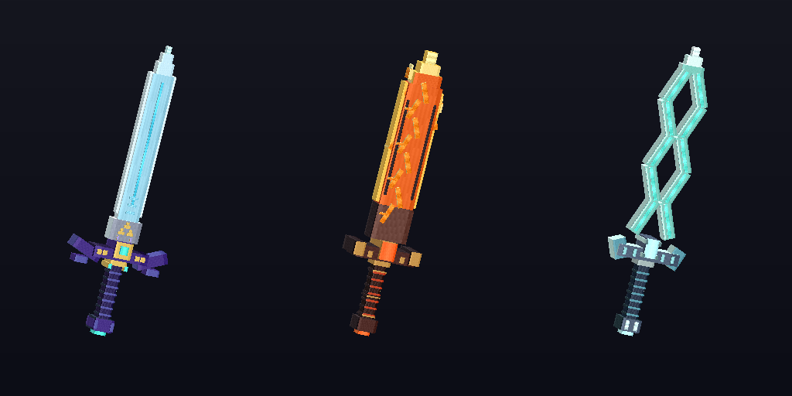

# LegendarySwords

Paper **1.21.11** plugin with eight detailed Zelda sword designs, visible abilities, charged ultimates, and bundled sword-specific BetterModel animations. **BetterModel 3.1 requires Java 25**; core combat without BetterModel can run on Java 21. Includes distinct laser, fire, lunar, ice, lightning, ground, wind, and heavy-blade effects. Ultimates release their attack after a shared scene, with a guarded fallback if presentation fails.

The artwork and animation keyframes are original fan-made assets inspired by the named swords. Server compilation and automated checks do not verify how Minecraft renders them; complete the [real-server checklist](docs/TESTING.md).

Version **0.2.6** plays character animations **only during abilities and ultimates**. Holding a sword, walking, running, ordinary swings and `/ls pose` keep normal player movement. The temporary cast body is restored when its clip or scene ends; no idle/walk/run body remains attached afterward.

Ultimates now play a shared charge/reveal scene **before releasing the attack and damage**. The blade appears 2.5 blocks ahead of the caster, with sword-specific reveal motion. The caster and visible nearby players within 40 blocks receive the same scene title; world particles and displays are shared. The ultimate pose holds until scene completion. A guarded timeout releases a stalled scene once, while cancellation on death, teleport, world change or shutdown disarms pending damage. This is an in-world scene, without changing game mode or forcing a camera/teleport.

The inventory-copy and server-thread snapshot hardening from 0.2.3 is retained. Temporary cast bodies still use BetterModel's player equipment path: **the earlier equipment-packet disconnect has not been verified on a live client**. Set `bettermodel.cast-body-animations: false` to retain attack effects and scenes without character disguises if it recurs. Keep the existing **0.2.2 combined pack**; this version changes no models or client assets.



## Install or update

1. Stop the server, remove the old LegendarySwords JAR from `plugins`, upload **`LegendarySwords-0.2.6.jar`**, then restart. Keep your configuration and player data.
2. Keep `bettermodel.enabled: true`, `bettermodel.abilities-only: true` and `bettermodel.cast-body-animations: true`. Missing new keys use true, including old 0.2.3 configurations with `player-body-animations: false`. That old flag controls only the optional legacy locomotion mode.
3. Keep your installed **0.2.2 combined pack**. First installations and upgrades from older packs should install it zipped. No new BetterModel `build.zip` is needed unless other server models or generated pack settings changed.
4. Run `/ls cinematics on`, `/ls cinematics status` and `/ls status`. Keep server `cinematics.enabled: true`. Test an ultimate with `/ls charge 100`, then sneak + right-click. `/ls resetcooldowns` permits another test.
5. Test with another player watching you. Normal movement should return when each cast finishes. Player damage remains controlled by `pvp-enabled` and your protection plugins; enable PvP deliberately if player targets should take damage.

You do not need Java or Maven installed on your computer to upload the compiled plugin. The server needs **Java 25 when using BetterModel 3.1**. BetterModel is optional for combat and particle/display effects; its generated pack is required for body animations and slash models. The integration uses **BetterModel 3.1's API**. The installed `3.1-SNAPSHOT-526` build needs a real-server animation check; compilation cannot prove snapshot runtime behavior.

**Right-click** uses an ability. **Sneak + right-click** uses the ultimate at 100 charge. Successful normal melee hits earn **10 charge**, and melee kills add **20** more. Ability damage does not generate charge. `/ls pose` is unavailable in cast-only mode; ability and ultimate character clips play during casts.

| Sword ID | Right-click ability | Charged ultimate | Default cooldowns |
| --- | --- | --- | --- |
| `master_sword` | Skyward Laser: sustained luminous beam | Triforce Judgment: sacred beam attack | 7 s / 75 s |
| `flameblade` | Ring of Fire: visible ring of flames | Inferno Vortex: expanding fire columns | 9 s / 90 s |
| `fierce_deity_sword` | Lunar Crescent: traveling crescent | Falling Moon: lunar meteors | 8 s / 90 s |
| `frostblade` | Ice Fang: rising ice spikes | Frozen Sanctuary: swirling blizzard | 8 s / 80 s |
| `thunderblade` | Chain Lightning: connected lightning strikes | Thunderstorm: overhead storm strikes | 9 s / 85 s |
| `royal_claymore` | Royal Faultline: ground fissure | King's Verdict: giant blade slam | 10 s / 95 s |
| `eightfold_blade` | Gale Step: traveling wind ribbons | Eightfold Tempest: angled wind cuts | 6 s / 70 s |
| `biggoron_sword` | Goron Spin: oversized spinning blade | Mountain Breaker: radial earth eruption | 12 s / 100 s |

Cooldowns, damage, charge, PvP, and presentation settings are configurable. Particles and temporary display models provide visible attacks even when BetterModel is absent. These effects do not permanently alter terrain. Player ability damage is disabled by default; test your protection plugins before enabling PvP.

See [Minehut and Windows installation](docs/INSTALLATION.md), [BetterModel setup and pack merging](docs/BETTERMODEL.md), and [the testing checklist](docs/TESTING.md).

## Commands

`/legendaryswords`, `/ls`, and `/swords` refer to the same command. Give, charge, and cooldown reset commands can target yourself in-game or name an online player; use a named player from the console.

| Command | Purpose |
| --- | --- |
| `/ls give [player] <sword\|all>` | Give one sword or all eight |
| `/ls list` | List sword IDs, abilities, and ultimates |
| `/ls charge [player] <0-100>` | Set ultimate charge for testing |
| `/ls resetcooldowns [player]` | Clear that player's cooldowns for testing |
| `/ls pose` | Available only in the optional legacy animation mode |
| `/ls cinematics [on\|off\|status]` | Enable, disable, inspect or toggle your ultimate scenes |
| `/ls pack` | Request the configured resource pack |
| `/ls status` | Show plugin, pack, and animation status |
| `/ls reload` | Reload plugin configuration |

`legendaryswords.admin` controls give, charge, reset, and reload commands and defaults to operators. `legendaryswords.use` permits sword abilities and poses and defaults to everyone. The pose has a short two-second cooldown.

## Build from source

Install a **Java 25+ JDK** and **Maven 3.9+**, then open a terminal in the folder containing `pom.xml`. The BetterModel API dependency requires the newer JDK even though core plugin classes target Java 21:

```sh
mvn --batch-mode verify
```

This runs Java unit tests and creates `target/LegendarySwords-0.2.6.jar` and `target/LegendarySwords-resource-pack.zip`. Python 3's standard library can validate the pack and create the source, model, and complete download ZIPs:

```sh
python3 scripts/build_resource_pack.py --validate-only
python3 scripts/test_resource_pack.py
python3 scripts/test_bettermodel_assets.py
python3 scripts/create_release.py
```

The complete bundle contains the JAR, sword pack and hash, source ZIP, separate sixteen-model BetterModel ZIP, and beginner installation notes. It can include the existing combined pack under a byte-identical 0.2.6 alias. The 0.2.6 hotfix requires no new BetterModel `build.zip`; regenerate it only if other models or generated client assets change.

Build outputs in `target/` are ignored by Git. [The installation guide](docs/INSTALLATION.md#put-the-source-in-your-github-repository) explains extracting the source into an existing GitHub Desktop repository.

## Visual limits and validation

The sword pack provides custom geometry, animated energy textures, glint, and optional emissive overlays. Shader bloom and light illuminating nearby blocks depend on compatible client support. Temporary attack displays use full brightness but do not emit world lighting.

The 0.2.6 default keeps normal player movement outside casts and plays only `ability` and `ultimate` body clips, together with attack effects and shared ultimate scenes. **The vanilla first-person arm swing is unchanged.**

`bettermodel.abilities-only: false` plus `bettermodel.player-body-animations: true` enables the old locomotion mode for controlled testing. It is not needed for cast-only animations. Temporary bodies select the `_animated` held-item model; ending a cast restores the base model. The inventory icon and first-person sword stay visible with the 0.2.2 pack.

Automated tests cover mechanics and mocked lifecycle/protection behavior; pack checks verify file structure, references, textures, and animation data. Real client presentation, installed BetterModel compatibility, and multiplayer behavior remain manual server checks.

Version 0.2.6 hides vanilla body/equipment for observers during casts. The caster keeps normal rendering and inventory, preventing a duplicate body from blocking the camera. Ultimate windups default to 24 ticks (1.2 seconds), including upgraded configurations; set `cinematics.windup-ticks` to customize. Damage uses Paper's standard armor, toughness, protection and resistance calculations.

## Ultimate speed and damage tuning

Edit `plugins/LegendarySwords/config.yml`, then run `/ls reload`:

```yaml
ultimates:
  speed: 2.0 # Twice as fast; 1.0 normal, 0.5 half speed.
damage:
  ability-multiplier: 1.5
  ultimate-multiplier: 2.0
```

Speed controls the charge/reveal delay before the attack starts and scales the character clip to fit it. It does not change cooldowns, beam travel speed or repeated-hit intervals. The base delay is `cinematics.windup-ticks: 24` (1.2 seconds); speed 2.0 makes it 0.6 seconds. Set `swords.master_sword.ultimate-speed: 0.5` for an optional per-sword override. Speed is bounded to 0.25–4.0, with a final delay of 4–160 ticks.

Ability damage now defaults to 1.5 times each sword's configured `ability-damage`; ultimate damage defaults to 2 times its configured `ultimate-damage`. These multipliers also apply when the keys are missing in an older configuration. Set either multiplier to 1.0 to restore previous damage. Melee damage is unchanged. Armor, toughness, protection and resistance remain handled by Paper.

## Separate admin plugin

[LegendaryAdmin](admin-plugin/README.md) adds `/la` moderation commands, a player-selection admin menu, vanish and read-only inventory viewing. Download [LegendaryAdmin-0.1.0.jar](https://github.com/edwardsunghukim-glitch/LegendarySwords/raw/refs/heads/main/downloads/LegendaryAdmin-0.1.0.jar) and install it alongside the swords plugin. No resource pack is needed. Build it separately with `mvn -f admin-plugin/pom.xml verify`.
